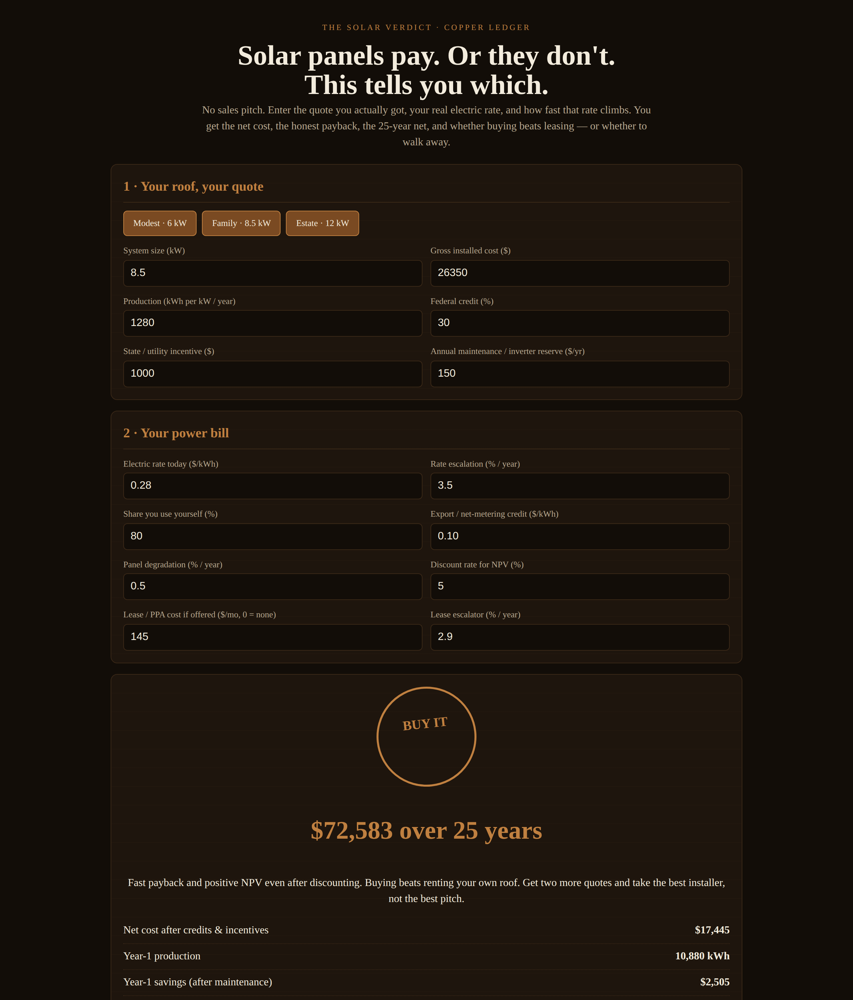

# The Solar Verdict

**Live:** https://thebullbrew.github.io/solar-verdict/

Rooftop solar judge for homeowners — no sales pitch. Enter the quote you actually got, your real electric rate, and how fast that rate climbs.

## What it does
- Net cost after federal credit and state/utility incentives, plus cost per watt
- Year-1 production and savings, split between power you use yourself (full retail value) and power you export (lower credit)
- Honest payback with rate escalation and panel degradation year by year
- 25-year gross savings, net, and NPV at your discount rate
- Breakeven electric rate — the rate you'd need for payback by year 15
- BUY IT / CLOSE CALL / SKIP IT verdict seal
- Lease/PPA showdown: 25-year lease total vs buying's net benefit
- Rate-escalation sensitivity table (0–7%/yr) — the assumption salesmen hide behind
- Presets, saveable scenarios (localStorage), copy summary. Works offline as a PWA.

## The method
Self-used power is worth your full retail rate; exported power is worth only the net-metering credit — that split decides most deals. Savings compound with rate escalation but shrink with degradation, and NPV stops a slow 25-year "win" from masquerading as a good investment today.

## Run it
Open `docs/index.html` in any browser, or use the live link above. No backend, no build step.
